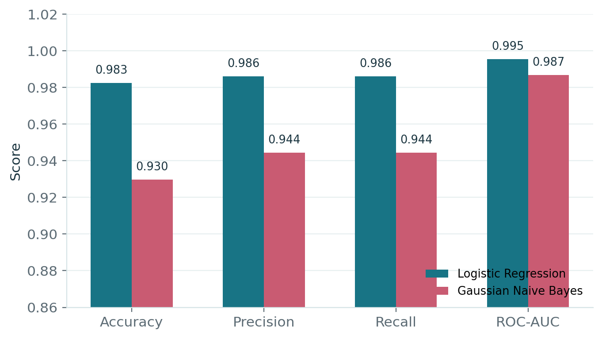
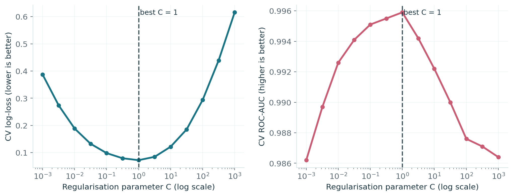
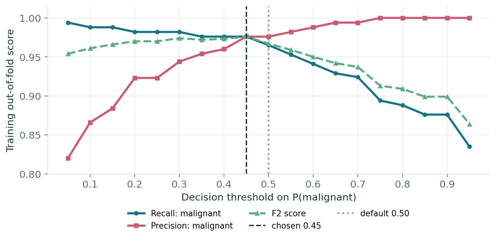
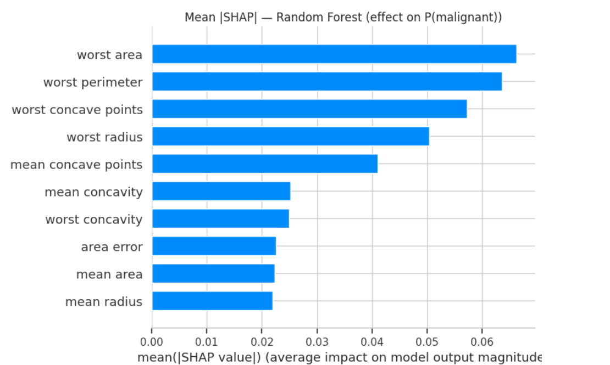
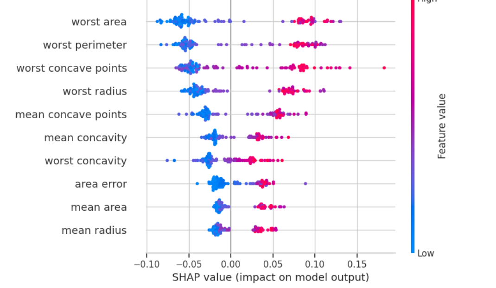
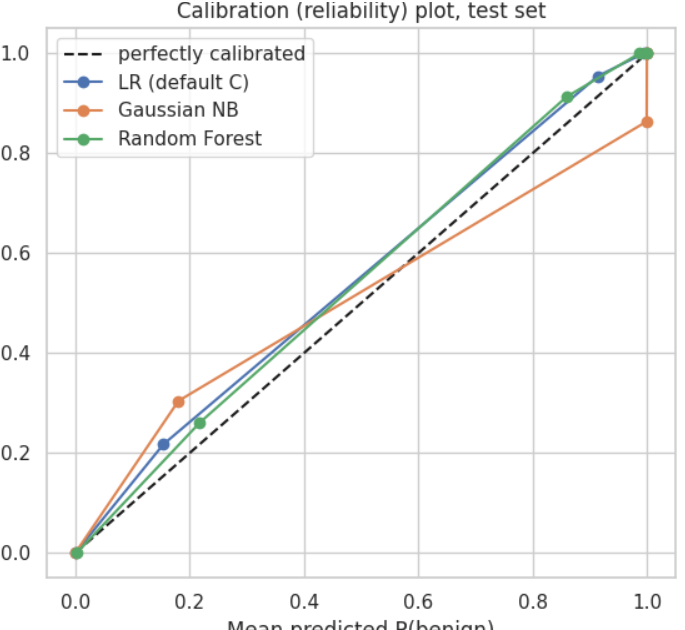

# Breast Cancer Classification Using Probabilistic Machine Learning

**A Probability and Statistics project comparing Logistic Regression, Gaussian Naive Bayes, and Random Forest on the Wisconsin Diagnostic Breast Cancer dataset.**



> **Scope:** This is an educational, tabular machine-learning benchmark, **not a medical diagnostic system**. The dataset already contains numerical features extracted from biopsy images; this project does not analyze raw scans or replace a qualified clinician.

## Project overview

The project predicts whether a tumor sample is **malignant** or **benign** from 30 numerical measurements of cell nuclei. The primary objective is to demonstrate probability and statistics concepts through a practical binary-classification experiment: **conditional probability, Gaussian likelihoods, Bayesian inference, maximum likelihood estimation (MLE), log-odds, hypothesis testing, cross-validation, and probability calibration**.

We completed the project in two stages:

- **Review 1:** Explored the dataset, implemented Logistic Regression (LR) and Gaussian Naive Bayes (GNB), evaluated confusion matrices and ROC-AUC, and interpreted model probabilities and coefficients.
- **Final review:** Investigated the accuracy gap statistically, tuned LR regularisation and its decision threshold, added a Random Forest comparison with SHAP interpretation, and assessed probability calibration.

## Dataset

| Property | Value |
|---|---|
| Name | Wisconsin Diagnostic Breast Cancer (WDBC) |
| Samples | 569 |
| Inputs | 30 numeric features (10 cell-nucleus properties × mean, standard error and worst) |
| Labels | 212 malignant, 357 benign |
| Missing values | 0 |
| Split | Stratified 80% training (455) / 20% testing (114) |
| Random seed | 42 |

The dataset is loaded via `sklearn.datasets.load_breast_cancer()`; no separate dataset download is needed. scikit-learn encodes **0 = malignant** and **1 = benign**. Baseline precision, recall, and F1 use *benign* as the positive class, while threshold tuning explicitly evaluates *malignant* recall. This distinction is important when interpreting the metrics.

## Methods

1. **Preprocessing:** Stratified train–test split and feature standardisation using parameters learned on training data only. Cross-validation uses pipelines to avoid leakage.
2. **Logistic Regression:** Sigmoid probability model fitted using L2-regularised log-loss (penalised maximum likelihood); its coefficients can be interpreted as changes in log-odds.
3. **Gaussian Naive Bayes:** Models each feature with a class-specific normal distribution and uses Bayes' theorem to estimate posterior class probabilities. Its conditional-independence assumption is challenging for correlated measurements such as radius, perimeter, and area.
4. **Model comparison:** Confusion matrices, accuracy, precision, recall, F1, ROC-AUC, five-fold cross-validation, and probability-quality metrics.
5. **Statistical checks:** Exact McNemar test on paired test-set predictions, a paired bootstrap confidence interval, and repeated cross-validation with a corrected t-test.
6. **Tuning and explanation:** Five-fold cross-validation over LR's `C`, F2-based threshold selection from out-of-fold training predictions, Random Forest feature effects using SHAP, and calibration plots.

## Main results

### Final held-out test-set comparison

| Model | Accuracy | ROC-AUC | Brier score ↓ | Log-loss ↓ | Malignant cases missed (out of 42) |
|---|---:|---:|---:|---:|---:|
| **Logistic Regression (default C = 1)** | **98.25%** | **0.9954** | **0.0215** | **0.0777** | **1** |
| Gaussian Naive Bayes | 92.98% | 0.9868 | 0.0602 | 0.4370 | 4 |
| Random Forest | 95.61% | 0.9931 | 0.0319 | 0.1089 | 3 |
| LR, threshold 0.45 | 95.61% | 0.9954 | 0.0215 | 0.0777 | 1 |

**Interpretation:** Logistic Regression gave the strongest results on this particular held-out split. The threshold-adjusted LR has the same underlying probability estimates (and therefore the same AUC, Brier score and log-loss), but different class predictions. These results do not establish clinical suitability or universal model superiority.

### Was the LR–GNB accuracy gap statistically supported?

- LR correct and GNB wrong: **6** patients; GNB correct and LR wrong: **0** patients.
- **Exact McNemar p = 0.0312** for the planned LR–GNB comparison.
- Test accuracy difference: **+5.26 percentage points**, with paired-bootstrap **95% CI +1.75 to +9.65 percentage points**.
- Repeated 5-fold CV (10 repeats): average LR **97.89%**, GNB **93.20%**, corrected t-test **p ≈ 0.00116**.

**Multiple-comparison caution:** If all three pairwise model tests are treated as one family, Bonferroni-adjusted LR–GNB p = **0.0938**; that adjusted result does **not** pass the 0.05 threshold. The small test set also limits precision.

### Did tuning improve the classifier?

- Five-fold CV on the training set selected **C = 1.0**, already the scikit-learn default; this was a legitimate negative tuning result.
- Training-only out-of-fold F2 optimisation selected a **malignant probability threshold of 0.45** instead of 0.50.
- On the test set, **both thresholds caught 41 of 42 malignant cases**. Lowering the threshold increased benign false alarms from **1 to 4**, reducing test accuracy from **98.25% to 95.61%**. The adjusted threshold therefore did **not** improve malignant detection on this split.





### Random Forest and SHAP

Random Forest attained **95.61% test accuracy** and **0.9931 ROC-AUC**. Mean absolute SHAP values ranked **worst area, worst perimeter, worst concave points, and worst radius** among the most influential features. Six features overlapped between the top ten SHAP-ranked RF features and the top ten LR coefficients by absolute magnitude; the overall Spearman rank correlation was **0.71**. SHAP explains the fitted model's behavior, not causal medical effects.





### Probability calibration

The LR and RF reliability curves were closer to the reference diagonal than the GNB curve in this test-set plot. LR also had the lowest Brier score (**0.0215**) and log-loss (**0.0777**) among the three models. Small-sample calibration bins are noisy, so the graph is exploratory.



## Repository layout

```text
breast-cancer-probabilistic-classification/
├── README.md
├── requirements.txt
├── .gitignore
├── notebooks/
│   ├── 01_review1_baseline.ipynb
│   └── 02_final_review_analysis.ipynb
├── src/
│   ├── review1_baseline.py
│   └── final_review_analysis.py
├── figures/                     # Curated result illustrations
├── results/README.md             # Generated output instructions
├── reports/ieee_report_review1.pdf
├── presentation/
│   ├── review1_slides.pdf
│   ├── final_review.pptx
│   └── final_review.pdf
└── tests/test_baseline.py
```

**Report status:** The supplied IEEE report documents the earlier LR–GNB study. It has **not** been updated to incorporate all final-review experiments; refer to the final presentation and the final-review code for the extension results.

## How to run

### Option A: Google Colab

1. Open either notebook under `notebooks/` in [Google Colab](https://colab.research.google.com/).
2. For the final-review notebook, the original first code section attempts to mount Google Drive to `/content/drive` and work in `MyDrive/breastcancer-project`. Authorise this if you want persistent output; otherwise remove that optional mount section to save in the Colab working directory.
3. Install the packages from `requirements.txt` if necessary and choose **Runtime → Run all**.
4. Charts, CSV comparisons, and a JSON summary appear under `outputs/`.

### Option B: Local Python

Use a Python environment compatible with the versions in `requirements.txt` (Python 3.11 is a reasonable choice).

```bash
python -m venv .venv
# Linux/macOS: source .venv/bin/activate
# Windows PowerShell: .venv\Scripts\Activate.ps1
pip install -r requirements.txt
python src/review1_baseline.py
python src/final_review_analysis.py
python tests/test_baseline.py
```

The original final-review script checks for `google.colab` and only mounts Drive when run in Colab. Its output directory is created automatically. Plotting commands may open windows in desktop environments.

## Limitations and future work

- Only **114 held-out test samples**, including **42 malignant** cases, so a difference of one or two predictions can change the results substantially.
- Correlated inputs can violate GNB's independence assumption.
- Comparison is on one public dataset, not external clinical data.
- Threshold decisions require explicit error-cost trade-offs; on this test split, the lower threshold increased false positives without detecting another malignancy.
- Future work could add external validation, larger and more diverse datasets, robustness checks, and uncertainty analysis.

## Authors and course

**Shubhang Shrivats · Aryan Singh · Sarasij Roy**  
Probability and Statistics (BAMAT207) · Vellore Institute of Technology (VIT), Vellore  
Faculty: Dr. Pallavi Mishra

## Dataset reference

Wolberg, W., Street, W., & Mangasarian, O. (1995). *Breast Cancer Wisconsin (Diagnostic)*. UCI Machine Learning Repository. https://doi.org/10.24432/C5DW2B

The project is provided for academic demonstration. No open-source license has been selected for this repository.
